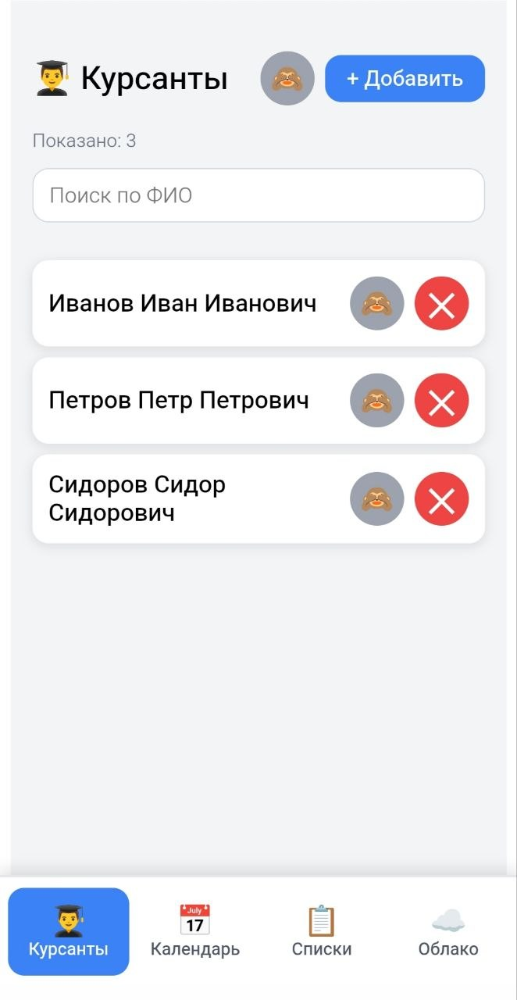
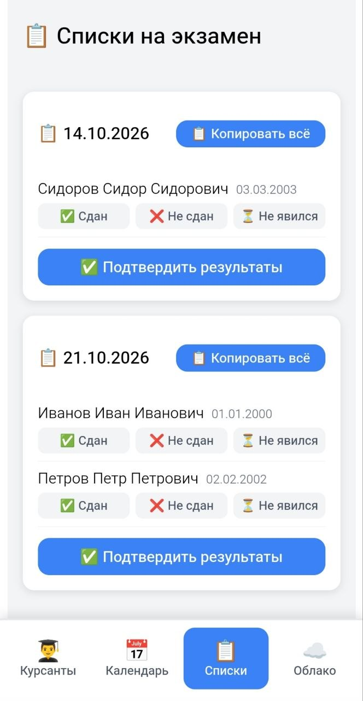

# Экзамены

Android-приложение для автоинструктора: учёт курсантов, запись на экзамены по средам и фиксация результатов.

Собрано как вайбкодинг-проект: реальная задача с телефона, без бэкенда и без магазина приложений. Поставил APK, пользуются, правки выкатываются новой сборкой.

<p align="center">
  
  
</p>

Репозиторий: [github.com/Sibarit87/exam](https://github.com/Sibarit87/exam)

## Зачем

В автошколе экзамены идут по средам. Нужно помнить, кто уже ходил, сколько попыток, когда человеку снова можно сдавать, и быстро выгрузить список на день. Excel и бумажки ломаются. Приложение живёт на телефоне и не требует интернета для повседневной работы.

## Что умеет

- Карточка курсанта: ФИО, дата рождения, история попыток
- Календарь ближайших сред с записью и снятием с экзамена
- Списки на день: копирование ФИО в буфер, отметки «сдан / не сдан / не явился»
- Паузы между попытками: 7 дней после 1–2, 6 календарных месяцев после 3-й и дальше (срок с следующего дня, записывать можно со дня после окончания)
- Скрытые курсанты не попадают в календарь и списки
- Поиск по ФИО и алфавитный порядок в открытом и скрытом списках
- Перенос данных на новый телефон через файл в Яндекс.Диск, Google Drive или Telegram

Данные хранятся локально. Облако здесь — это шаринг JSON-копии, не сервер.

## Стек

React 19 · TypeScript · Vite · Capacitor 8 · Android

Без своей базы и API. Состояние в `localStorage`, бэкап через `@capacitor/filesystem` и `@capacitor/share`.

## Как это делалось

Писал с ИИ в Cursor: сначала рабочий APK, потом итерации по живым кейсам. Пауза «не 182 дня, а 6 месяцев», пустые списки после снятия всех с даты, поиск по скрытым — это правки от реального использования, а не из ТЗ.

## Собрать самому

```bash
npm install
npm run build
npx cap sync android
```

Release APK собирается Gradle-сборкой Android-проекта. Готовый файл для установки — локально в `apk/exam.apk` (в git не лежит).
